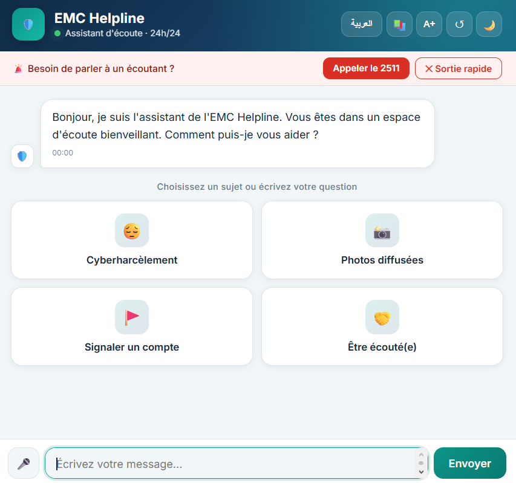
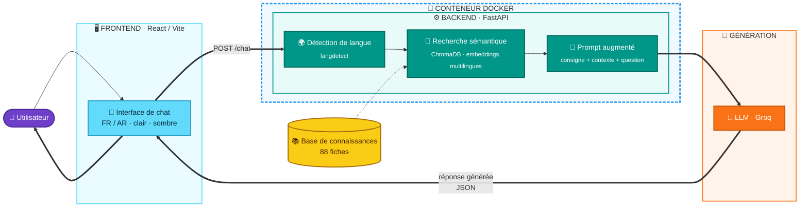
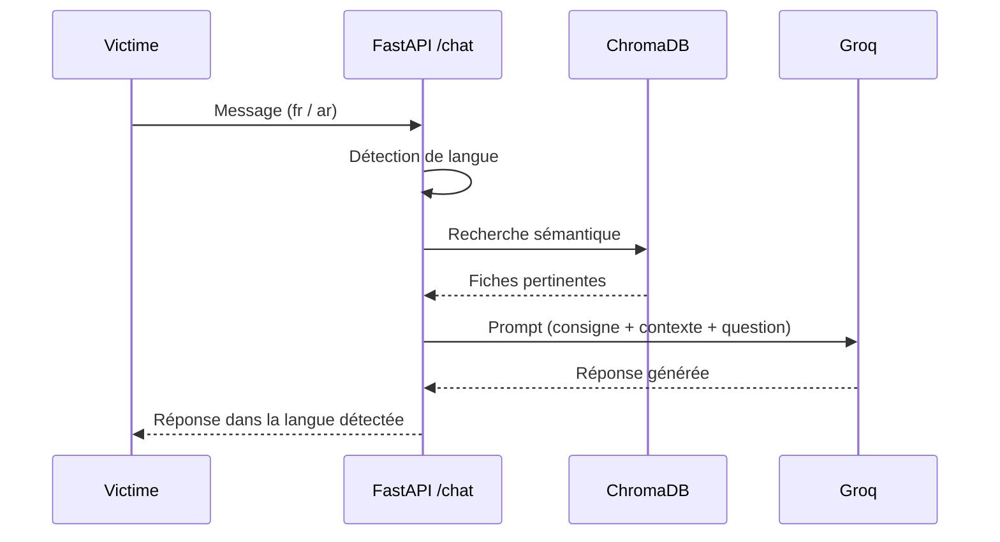

# 🛡️ EMC Helpline

### Chatbot IA multilingue d'assistance aux victimes de cyberviolences

*Une architecture **RAG complète** — détection de langue, recherche sémantique et génération contextuelle — mise au service d'un cas d'usage réel : écouter, comprendre et orienter les victimes de cyberviolences, en français comme en arabe.*

**Projet N°12 — Stage PFA 2026** · Espace Maroc Cyberconfiance (EMC) — CMRPI
Encadrante : Dr. Assiss Bouchra


---

## 📖 Sommaire

- [Description](#-description)
- [Fonctionnalités](#-fonctionnalités)
- [Architecture](#-architecture)
- [Pipeline RAG](#-pipeline-rag)
- [Stack technique](#-stack-technique)
- [Structure du projet](#-structure-du-projet)
- [Installation](#-installation)
- [Variables d'environnement](#-variables-denvironnement)
- [Utilisation](#-utilisation)
- [Docker](#-docker)
- [Tests effectués](#-tests-effectués)
- [Auteure](#-auteure)

---

## 📌 Description

Une victime de cyberharcèlement a besoin d'information et d'orientation **rapides, fiables et dans sa langue**. **EMC Helpline** est un assistant conversationnel qui :

- 🧭 répond aux questions sur le cyberharcèlement à partir d'une base de connaissances dédiée ;
- 🔎 retrouve le contexte pertinent par **recherche sémantique**, pas par simple mot-clé ;
- 🚨 détecte une situation de détresse grave et déclenche un **protocole d'urgence** prioritaire (numéro d'assistance 2511) ;
- 🌍 fonctionne nativement en **français** et en **arabe**.

> Développé dans le cadre d'un **stage de fin d'année (PFA)** en Génie Informatique, orientation DevOps.

## 🖼️ Aperçu



## ✨ Fonctionnalités

| | Fonctionnalité |
|:---:|---|
| ✅ | Détection automatique de langue (français / arabe) |
| ✅ | Extraction et découpage de la base de connaissances en 88 fiches |
| ✅ | Recherche sémantique — embeddings multilingues + base vectorielle ChromaDB |
| ✅ | Génération de réponses contextualisées (RAG + LLM) |
| ✅ | Protocole d'urgence — détection de détresse → message de sécurité prioritaire |
| ✅ | Interface de chat React — thème clair/sombre, bascule FR/AR (mise en page de droite à gauche), dictée vocale |
| ✅ | Sortie rapide : bouton ou double appui sur Échap, efface la conversation et quitte la page |
| ✅ | Cartes de sujets, fenêtre de ressources, taille du texte réglable |
| ✅ | Message d'attente bienveillant avec le 2511 si le modèle est indisponible |
| 🐳 | Dockerfile du backend fourni |

## 🏗️ Architecture



> 🐳 Le backend complet (détection de langue → recherche → prompt) peut être exécuté dans un **conteneur Docker** (Dockerfile fourni).

**Frontend** — envoie le message de l'utilisateur, affiche la réponse reçue.
**Backend** — détecte la langue, récupère le contexte pertinent, construit le prompt, interroge le LLM.

## 🔄 Pipeline RAG



## 🛠️ Stack technique

**Backend**
- Python 3.12
- FastAPI
- Uvicorn

**IA / RAG**
- langdetect
- sentence-transformers `paraphrase-multilingual-MiniLM-L12-v2`
- ChromaDB
- Groq (LLM)
- langchain-text-splitters
- python-docx

**Frontend**
- React
- Vite

**Infrastructure**
- Docker (backend)
- Git / GitHub

## 📁 Structure du projet

```
emc-helpline/
├── backend/
│   ├── app/
│   │   ├── main.py          # API FastAPI — endpoint /chat
│   │   ├── language.py      # détection de langue
│   │   ├── knowledge.py     # extraction et découpage du document
│   │   ├── embeddings.py    # calcul des embeddings multilingues
│   │   ├── vectorstore.py   # ChromaDB : stockage et recherche
│   │   └── llm.py           # prompt RAG et appel au LLM
│   ├── data/                 # base de ressources, base ChromaDB
│   ├── Dockerfile
│   ├── .dockerignore
│   ├── requirements.txt
│   └── .env                  # non commité
├── frontend/
│   └── src/
│       ├── App.jsx
│       └── index.css
└── README.md
```

## ⚙️ Installation

**Backend**

```bash
cd backend
python -m venv venv
venv\Scripts\activate          # Windows
pip install -r requirements.txt
uvicorn app.main:app --reload
```

API disponible sur `http://127.0.0.1:8000` — documentation interactive sur `/docs`.

**Frontend**

```bash
cd frontend
npm install
npm run dev
```

## 🔑 Variables d'environnement

Fichier `backend/.env` *(à créer, jamais commité)* :

```env
GROQ_API_KEY=ta_clé_api
```

Clé gratuite disponible sur [console.groq.com](https://console.groq.com/keys).

## ▶️ Utilisation

```bash
curl -X POST "http://127.0.0.1:8000/chat?message=Comment porter plainte pour cyberharcèlement ?"
```

```json
{
  "reponse": "...",
  "langue": "fr"
}
```

## 🐳 Docker

Un Dockerfile est fourni pour le backend :

```bash
cd backend
docker build -t emc-helpline-backend .
docker run -p 8000:8000 --env-file .env emc-helpline-backend
```

## ✅ Tests effectués

- ✅ Questions présentes dans la base de connaissances → réponses fidèles et détaillées
- ✅ Questions hors sujet → réponse honnête, aucune information inventée
- ✅ Protocole d'urgence, en français et en arabe → message de sécurité correctement déclenché
- ✅ Détection de langue validée sur français, arabe, anglais et entrées non linguistiques

---

## 👩‍💻 Auteure

**Hafsa El BZOUR**
Élève-ingénieure en Génie Informatique
Projet de stage PFA 2026 — IA appliquée

